# 시각 경험 개선 (2026-11-20)

이모지와 납작한 카드뿐이던 화면을 **한지 디오라마** 미술 방향으로 바꿨다. 게임 규칙·채점·저장·문제 묶음은 그대로다(`src/core`는 그림 고르기용 `barnStage` 하나만 더했다).

- 디자인 가이드: [art-direction.md](art-direction.md)
- 자산 목록·프롬프트·크레딧: [assets.md](assets.md)
- 스크린샷: `screens/before/`, `screens/after/`, 나란히 비교 `screens/compare-*.webp` (웹 빌드, 412×892)

## 전후 비교

| 화면 | 전 | 후 |
| --- | --- | --- |
| 홈 | 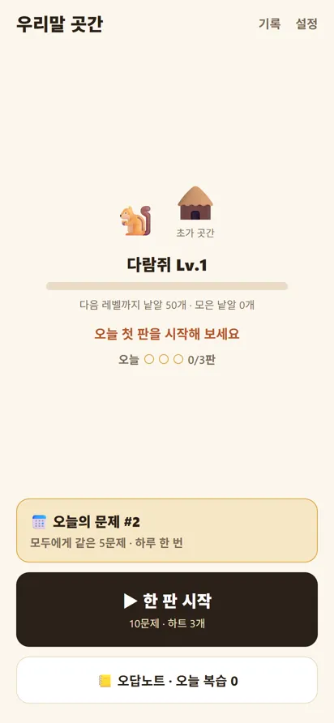 | 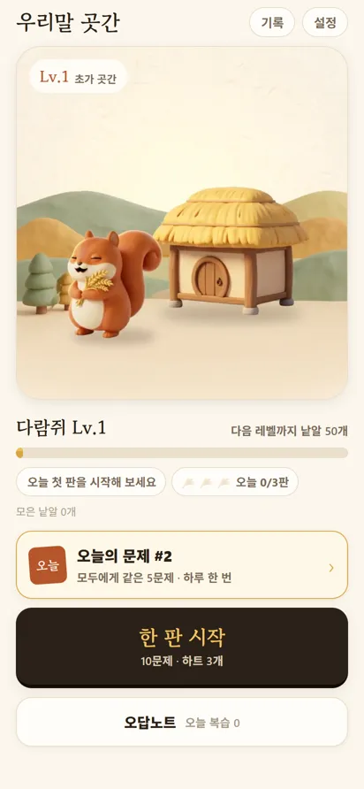 |
| 게임 | 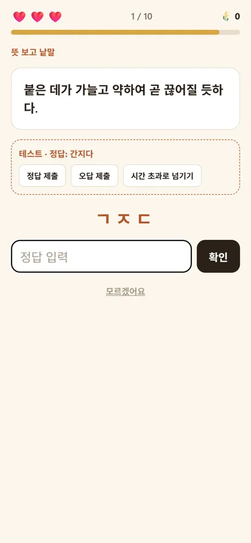 | 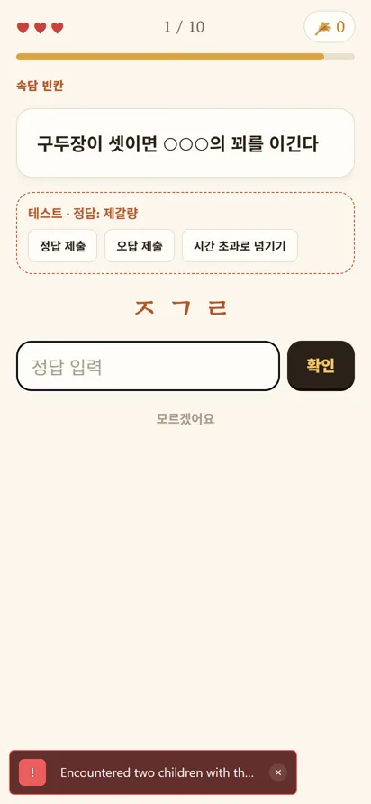 |
| 오답 | 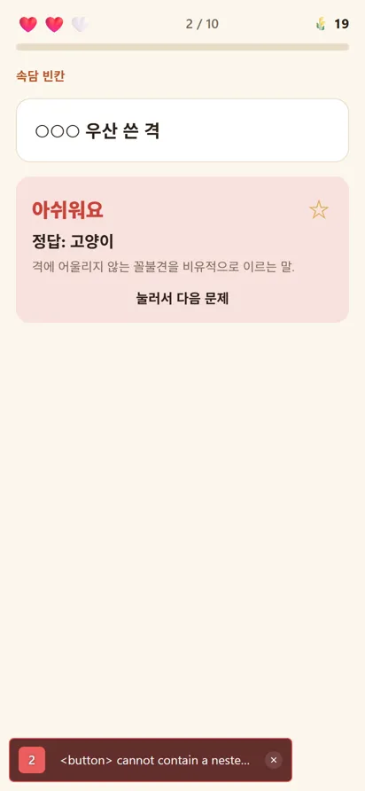 | 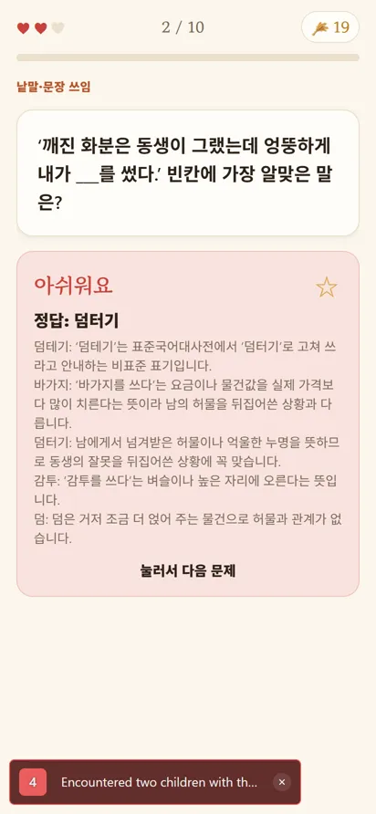 |
| 결과 | 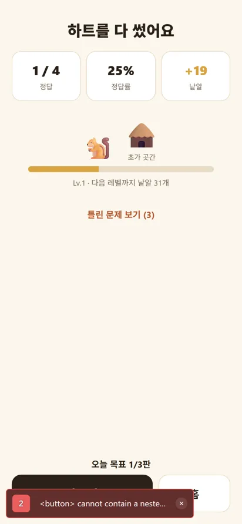 | 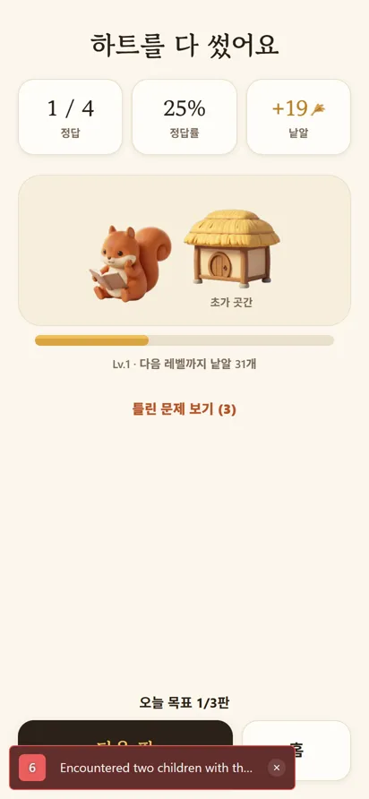 |
| 레벨업 결과 | — | 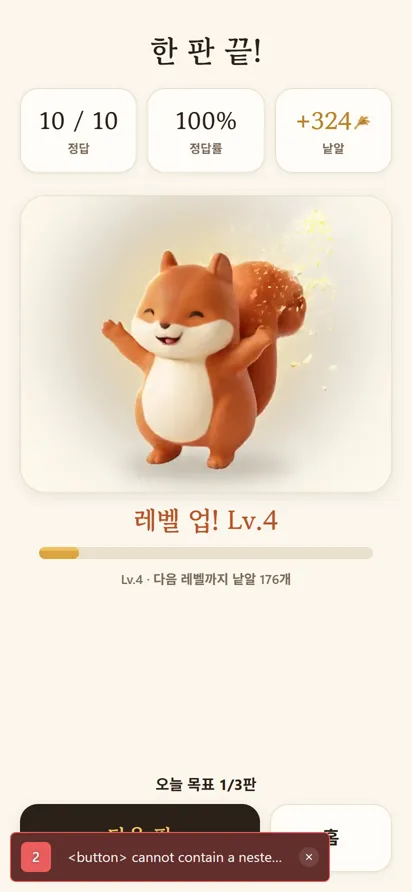 |
| 정답 연출 | 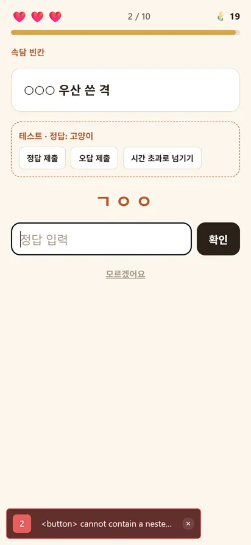 | 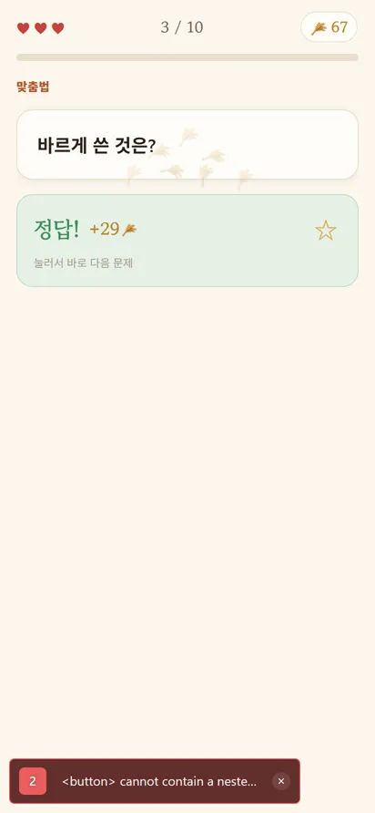 |
| 기록 | 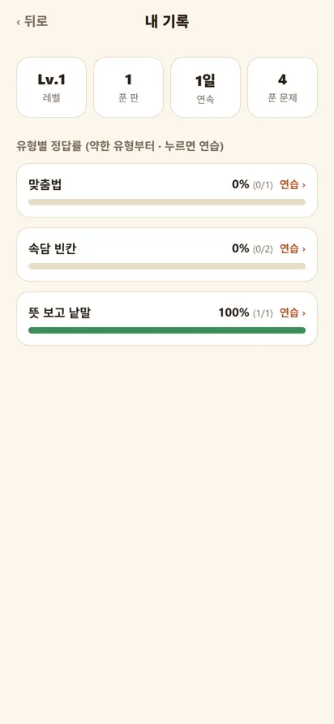 | 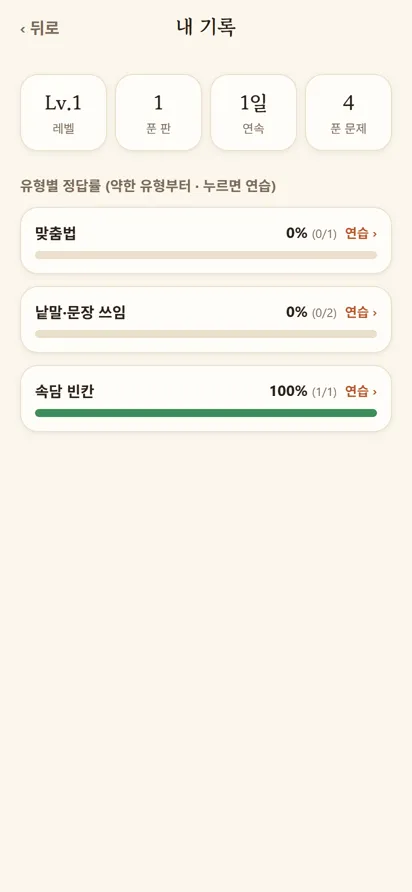 |
| 오답노트 | 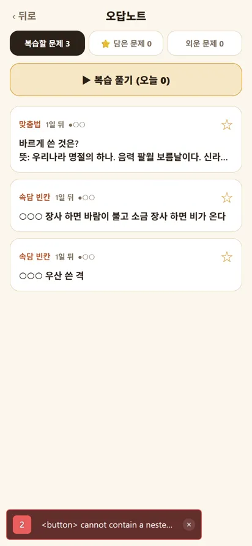 | 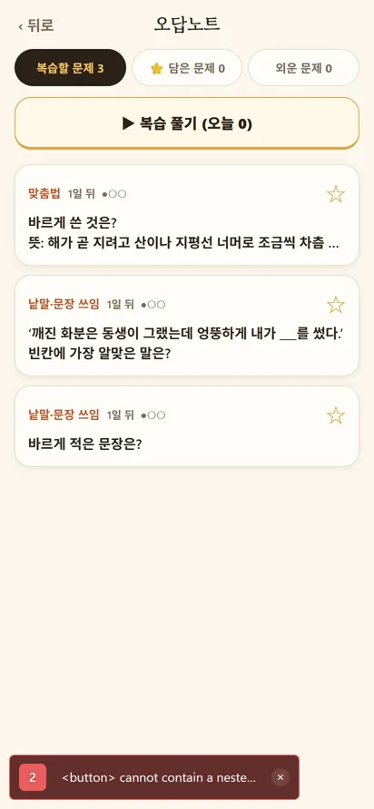 |

스크린샷 아래쪽의 빨간 띠는 개발 모드 웹 경고다(정답 카드 안의 ☆ 버튼이 버튼 안의 버튼이 되는 웹 전용 경고, 이번 작업 전부터 있던 것). Android 앱에는 나오지 않는다.

## 바뀐 것

- **디자인 시스템**: 색 토큰 확장, 고운바탕 제목·숫자, 종이 카드·그림자, 움직임 규칙(`src/ui/theme.ts`, `src/ui/motion.ts`)
- **홈**: 곳간 단계별 3D 디오라마 반복 영상, 레벨 배지, 채워지는 경험치 바, 연속·오늘 목표(낱알 3알)·도토리 칩, 도장이 찍힌 '오늘의 문제', 금빛 글자 주 버튼, 오늘 복습 배지
- **게임**: 벡터 하트(잃을 때 연출), 맥박치는 타이머, 낱알 카운터(톡), 문제 카드 등장, 정답 낱알 터짐, 오답 흔들림, 보기·입력·확인 버튼 재디자인
- **결과**: 정답률에 따라 다람쥐 포즈(환호·기본·책 읽기), 레벨업 영상, 곳간이 커질 때 새 곳간 표시, Reanimated 경험치 바
- **기록·오답노트·설정**: 종이 카드, 고운바탕 숫자·제목, 목록 차례 등장, 빈 화면에 책 읽는 다람쥐
- **아이콘·스플래시**: 다람쥐 캐릭터(adaptive 전경·배경·단색)
- **새 의존성**: `expo-video`(Expo 공식). Jest용 Reanimated 모의 모듈 `jest.setup.js`

## 검증

- `npm.cmd test`: 16개 묶음, 161개 테스트 통과(새 테스트: `barnStage`)
- `npx tsc --noEmit`: 오류 없음
- 웹(헤드리스 Chrome, 412×892): 홈 영상 재생, 테스트 모드로 10문제 정답 → 레벨업 영상·낱알 연출 확인, 콘솔 오류 없음(원격 묶음 CORS·기존 버튼 중첩 경고 제외)
- Android 에뮬레이터(Expo Go, API 36): 네이티브 번들이 실행되고(`Running "main"`) 이후 JS 오류·앱 중단 로그 없음. 다만 에뮬레이터 부하(load average 40)로 화면 캡처가 계속 시간 초과돼 **영상 재생·애니메이션은 눈으로 확인하지 못했다.** 실기기 확인 필요: 홈 영상 반복, 정답·오답 연출, 레벨업 영상, 설정 > 접근성 > 애니메이션 제거를 켰을 때 정지 그림으로 바뀌는지

## 앱 용량

| 항목 | 크기 |
| --- | --- |
| 그림(WebP 12개) + 영상(MP4 4개) | 656KB |
| 고운바탕 부분 글꼴 | 1.37MB |
| 합계 | 약 2.0MB |
